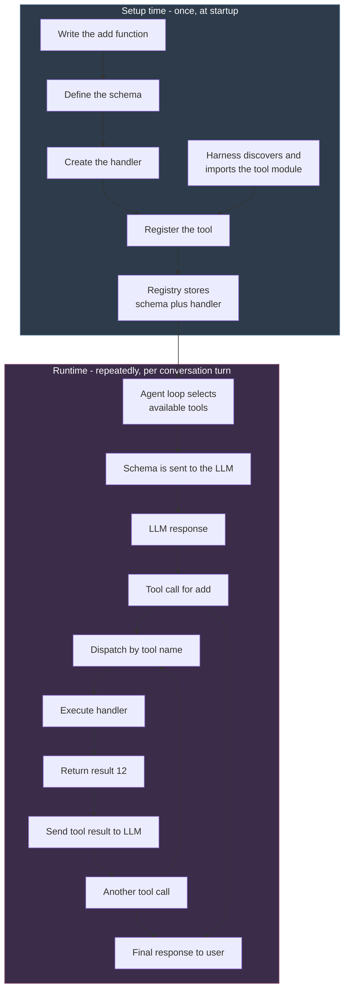

# Day 2, Component 2 — Tool Registry: From Zero to Execution

We build the mental model from scratch, using only one example: a
Python function called `add(a, b)`. We start with an ordinary
function, understand why a harness needs additional machinery, and
then follow the tool all the way from creation to an actual LLM call.

The goal is not to memorize Hermes's code. It is to understand why
each component exists, what problem it solves, and how the components
work together.

Grounded in real Hermes source, verified by reading the actual files,
not assumed: `/home/ubuntu/.hermes/hermes-agent/tools/registry.py`
(1,335 lines), `tools/approval.py` (5,498 lines), `toolsets.py`
(1,083 lines), and real individual tool files like
`tools/computer_use_tool.py` and `tools/close_terminal_tool.py`.

---

## First, understand the problem we are solving

Suppose we have this Python function:

```python
def add(a, b):
    return a + b
```

If you write this in Python:

```python
result = add(7, 5)
print(result)  # 12
```

Everything works. Python calls the function, performs the addition,
and returns `12`.

But now imagine we want an AI agent to use this function. The user
says: *"What is 7 plus 5?"*

The LLM understands the question, but understanding a task and
executing Python code are two different things. We need a mechanism
that lets the model request our function and lets our application
execute it. That is the problem the tool system solves.

| Actor | Role |
|---|---|
| **User** | "What is 7 plus 5?" |
| **LLM** | Understands the request and may request the `add` tool. |
| **Harness** | Receives the request and executes the correct function. |
| **Python function** | `add(7, 5)` returns `12`. |
| **LLM** | Uses the result to answer: "7 plus 5 is 12." |

Keep this principle in mind throughout: **the LLM decides what tool to
request. The harness controls how that request gets executed.**

Now let's build the system in the correct order.

---

## Stage 1 — Creation: build the tool

### Step 1. Create the ordinary Python function

```python
def add(a, b):
    return a + b
```

- `add` is the function's name.
- `a` and `b` are its parameters.
- `return a + b` is its implementation.

This is an ordinary Python function. It knows nothing about AI, LLMs,
tool calling, or harnesses. It can be called by any Python code that
has access to it.

**Important:** creating a function does not automatically make it
available to an LLM. We need to solve another problem first.

### Step 2. The LLM needs to know that the function exists

Imagine I give you access to a Python function but never tell you its
name, purpose, or required inputs. How would you know when to use it?
You wouldn't. The LLM has the same problem. Our harness needs to give
the model a description of the available tool — a **tool schema**:

```python
ADD_SCHEMA = {
    "name": "add",
    "description": "Add two numbers together.",
    "parameters": {
        "type": "object",
        "properties": {
            "a": {"type": "number"},
            "b": {"type": "number"},
        },
        "required": ["a", "b"],
    },
}
```

**What is a schema?** A structured description of what the tool looks
like to the model. It answers three questions:

| Field | Question it answers |
|---|---|
| `name` | What is the tool called? |
| `description` | What does the tool do? |
| `parameters` | What inputs does the tool need? |

The `parameters` field uses a JSON-Schema-style structure to describe
valid inputs: the inputs are an object, with two properties `a` and
`b`, both numbers, both required. This tells the model how to
construct a valid request. **The model sees the schema, not the
Python implementation itself.**

### Step 3. We need a way to connect the schema to the function

We now have two separate things:

- **Thing A — the implementation:** `def add(a, b): return a + b` —
  the real code that performs addition.
- **Thing B — the schema:** `{"name": "add", ...}` — the description
  that tells the LLM how to request addition.

These serve different purposes: the schema tells the model HOW to
request the tool; the implementation performs the actual work. But how
do we connect them? We need a callable function that the harness can
execute when the model requests `add`. This brings us to the
**handler**.

### Step 4. What is a handler?

Suppose the LLM requests this:

```json
{"a": 7, "b": 5}
```

This is the argument data the model provides. In Python, the harness
represents it as a dictionary: `args = {"a": 7, "b": 5}`.

Now imagine the harness uses the same generic execution rule for
EVERY tool, no exceptions:

```python
result = handler(args)
```

Notice the harness always passes ONE dictionary to the handler.
However, our original function expects two separate arguments:
`add(7, 5)`. If we try to pass the dictionary directly, the call won't
match the function's signature — Python would try to run
`add({"a": 7, "b": 5})`, and crash with a missing-argument error. We
need a small adapter between the harness and our function:

```python
def add_handler(args):
    a = args["a"]
    b = args["b"]
    return add(a, b)
```

Trace what happens: the harness calls `add_handler({"a": 7, "b": 5})`
→ the handler extracts `a = 7`, `b = 5` → calls our real function
`add(7, 5)` → the function returns `12`.

**The handler is simply the callable that the harness invokes.** Here
it adapts the dictionary into the arguments our function expects. A
handler doesn't always need to be a separate adapter — if the
underlying function already accepts the expected argument format, it
can serve directly as the handler.

> **BUT HERMES DOES IT LIKE THIS** — the real signature registered in
> Hermes's own tool files is `handler=lambda args, **kw: ...`, not
> just `lambda args: ...`. Verified directly in
> `tools/computer_use_tool.py` and `tools/close_terminal_tool.py`:
> ```python
> handler=lambda args, **kw: handle_computer_use(args, **kw),
> ```
> The real `dispatch()` (`tools/registry.py`) accepts arbitrary extra
> keyword arguments and forwards them to every handler:
> `entry.handler(args, **kwargs)`. Our simplified `add_handler(args)`
> is correct for a tool that needs nothing beyond its own arguments —
> but a REAL handler can also receive session-level context (who's
> calling, which scope, etc.) through `**kwargs`, without that context
> ever needing to be part of the tool's own JSON schema. This doc's
> `add` example deliberately leaves this out because `add` never needs
> that extra context — but a real tool that DOES need it (e.g. one
> that behaves differently per-profile) would use it.

**What is a contract?** The harness expects every registered handler
to accept one argument dictionary and return a result — that's the
handler's calling contract:

```
Input:  one argument dictionary
Output: a result
```

The harness can follow the SAME execution rule for `add`, `search_web`,
`read_file`, or hundreds of other tools without needing to know their
internal implementations. There is also a broader TOOL contract: the
tool's name, description, input schema, and expected result. The
schema describes the input structure, while runtime validation and
application logic determine whether a particular request is actually
valid and permitted.

**Why this matters:** a common interface lets us add new tools
without rewriting the entire execution system every time.

### Step 5. Put the pieces together

```python
# tools/add_tool.py

# 1. Actual implementation
def add(a, b):
    return a + b

# 2. Description for the model
ADD_SCHEMA = {
    "name": "add",
    "description": "Add two numbers together.",
    "parameters": {
        "type": "object",
        "properties": {
            "a": {"type": "number"},
            "b": {"type": "number"},
        },
        "required": ["a", "b"],
    },
}

# 3. Adapter the harness can call
def add_handler(args):
    return add(args["a"], args["b"])
```

At this point we have created the function, described it to the
model, and prepared a handler. But we have not yet connected this tool
to the running harness. That's the next stage.

---

## Stage 2 — Registration and discovery: make the harness aware of the tool

We have created a tool module. The harness still needs to find it and
make its implementation available to the execution system. Two
concepts solve this problem: **discovery** (finding the tool module)
and **registration** (adding the tool to the harness's collection of
available tools).

### Step 6. What is registration?

Imagine our harness supports 100 tools. How does it answer: "Does a
tool named `add` exist? What schema should we show the model? Which
handler should we execute when `add` is requested?" We need ONE place
where the harness can look up tools by name — the **tool registry**.

A registry is essentially a shared lookup structure that stores the
tools the harness knows about. Conceptually:

```python
registry = {
    "add": {
        "schema": ADD_SCHEMA,
        "handler": add_handler,
    }
}
```

(The real Hermes implementation uses a `ToolRegistry` and `ToolEntry`
abstraction, but this dictionary illustrates the underlying idea.) The
registry connects three things: the tool's name, its schema, and its
handler. When the harness receives a request for `add`, it looks up
the matching entry rather than searching through source files or
hard-coding every function into its execution loop.

> **BUT HERMES DOES IT LIKE THIS** — the real `ToolEntry`
> (`tools/registry.py`) carries far more than name/schema/handler.
> Verified directly in source:
> ```python
> class ToolEntry:
>     __slots__ = (
>         "name", "toolset", "schema", "handler", "check_fn",
>         "requires_env", "is_async", "description", "emoji",
>         "max_result_size_chars", "dynamic_schema_overrides",
>     )
> ```
> Real extra fields our simplified `add` example never needs:
> `requires_env` (env vars the tool needs before it can run, e.g. an
> API key), `is_async` (see Step 11's note below), `emoji` (a small
> UI touch — each tool shows a matching emoji while running), and
> `dynamic_schema_overrides` (a callable that can patch the schema
> at `get_definitions()` time based on CURRENT runtime config — e.g.
> `delegate_task`'s description changes depending on the user's
> configured concurrency limits, so the model is never told a stale
> number). None of these matter for `add`, which is why they're
> omitted above — but they're real, and exist because Hermes has
> ~100+ genuinely different tools, each with different real needs.

### Step 7. How does a tool enter the registry?

A tool module includes a registration call:

```python
registry.register(
    name="add",
    toolset="math",
    schema=ADD_SCHEMA,
    handler=add_handler,
)
```

This adds an entry to the registry under the name `add`. The `schema`
tells the harness what to expose to the model. The `handler` tells it
what to execute. The `toolset` labels the tool as belonging to the
math group. **The registration call does not mean the model has
already called the function — it only makes the tool known to the
harness.**

**But who executes this registration line?** This is where discovery
matters. In Hermes, the tool module's registration call runs when the
module is IMPORTED. The sequence:

1. **Harness starts.**
2. **Discovers tool modules** — finds candidate Python files in
   `tools/`.
3. **Imports the relevant module** — its top-level Python code
   executes.
4. **Registration runs** — `registry.register(...)` fires.
5. **Registry contains `add`** — the tool is available for later use.

In the real Hermes loader, it first scans tool files with a cheap AST
check to identify which ones contain a registration call, THEN imports
only those modules — importing is what executes the registration
call. This is an implementation detail of that specific loader, not a
universal rule for every harness.

### Step 8. What are toolsets?

We have a registry containing individual tools. Now imagine we have:
`add`, `subtract`, `multiply`, `search_web`, `open_page`, `read_file`.
Suppose a particular agent session only needs math tools. We could
manually specify `allowed_tools = ["add", "subtract", "multiply"]` —
but with many tools and many sessions, repeatedly listing names
becomes inconvenient. So we introduce **toolsets**: named groups of
tool names.

```python
toolsets = {
    "math": ["add", "subtract", "multiply"],
    "browser": ["search_web", "open_page"],
}
```

| | Registry — individual tools and implementations | Toolsets — groups of names |
|---|---|---|
| `add` | schema + handler | belongs to `math` |
| `subtract` | schema + handler | belongs to `math` |
| `search_web` | schema + handler | belongs to `browser` |

The distinction is important: the **registry** answers "what is the
tool named `add`, and how can I execute it?" The **toolset** answers
"which tool names belong to the `math` group?" The toolset does NOT
duplicate schemas or handlers — it simply groups names that can be
resolved through the registry.

At this point we have completed the creation and setup side of our
journey. Now let's see how the LLM actually uses it.

---

## Stage 3 — Invocation and execution: let the LLM use the tool

Suppose the user asks: *"What is 7 plus 5?"* This is where the agent
loop begins working with the registry.

### Step 9. The harness exposes the tool to the LLM

**Registering a tool and showing it to the model are not the same
operation.** Registration makes the tool known to the harness.
EXPOSURE makes its definition available to the LLM, right before a
model request:

```python
schemas = registry.get_definitions(["add"])
```

The registry finds `add` and returns its schema. The agent loop then
sends the model a request containing the user's message AND the
available tool definition for `add`. The model can now consider
whether to use the tool.

In the real Hermes implementation, `get_definitions()` also checks
whether a tool is CURRENTLY available, using an optional
availability-check function (`check_fn`). A registered tool can
therefore exist in the registry without being offered to the model at
that moment — e.g. a browser tool might be registered but hidden when
its required browser dependency is unavailable. A tool can exist
without necessarily being usable in every session or environment.

### Step 10. The LLM decides whether to call the tool

The model receives the user's message and the available tool
definitions. It may answer directly, or request a tool call:

```
Tool name: add
Arguments: {"a": 7, "b": 5}
```

This is NOT the model executing Python. The model is producing a
structured REQUEST. The harness must still process that request.
**The schema gives the model a description of the available action;
the model's response tells the harness which action it wants to
perform.**

### Step 11. The harness dispatches the call

```python
result = registry.dispatch(
    name="add",
    args={"a": 7, "b": 5},
)
```

The registry looks up `add`, retrieves its `ToolEntry`, and calls the
handler stored in that entry:

```
dispatch("add", {"a": 7, "b": 5})
        |
        v
Look up "add" in the registry
        |
        v
Retrieve the registered handler
        |
        v
add_handler({"a": 7, "b": 5})
        |
        v
add(7, 5)
        |
        v
12
```

The registry is used TWICE, for two different purposes: (1) to
retrieve the SCHEMA exposed to the LLM (Step 9), and (2) to retrieve
the HANDLER that executes the LLM's request (this step). Both lookups
refer to the SAME registered tool entry.

> **BUT HERMES DOES IT LIKE THIS** — the real `dispatch()` does more
> than our simplified trace shows. Verified directly in
> `tools/registry.py`:
> ```python
> try:
>     if entry.is_async:
>         result = _run_async(entry.handler(args, **kwargs))
>     else:
>         result = entry.handler(args, **kwargs)
>     return self._normalize_handler_result(name, result)
> except Exception as e:
>     ...
>     return tool_error(sanitized)
> ```
> Two real things our `add` example doesn't need to show, because
> `add_handler` can't realistically fail or need async: (1) **every
> single handler call is wrapped in a try/except** — if a real tool's
> handler raises an exception (a network error, a bad file path,
> anything), `dispatch()` catches it and turns it into a clean
> `{"error": "..."}` string instead of crashing the whole
> conversation; (2) **a handler can be `async`** (for tools doing real
> I/O, like a network call) — `dispatch()` checks `entry.is_async` and
> bridges it through `_run_async()` so the rest of the system never
> needs to know or care whether a given tool's handler is sync or
> async.

### Step 12. The result goes back to the LLM

The handler returns `12`. The agent loop sends this result back to the
model so it can continue the conversation, recorded in the
conversation state in the format the model API expects:

```
User:       What is 7 plus 5?
Assistant:  Requested tool "add" with a=7, b=5.
Tool result: 12
```

The agent loop calls the model AGAIN, providing the conversation and
the tool result. The model now produces the final response: *"7 plus
5 is 12."*

The full cycle: (1) user asks a question → (2) LLM requests `add` →
(3) registry dispatches to the handler → (4) handler returns `12` →
(5) agent loop sends the result to the LLM → (6) LLM answers the user.
The model might request ANOTHER tool after receiving a result — if it
does, the harness executes that tool too, and this repeats until the
model gives a final answer or the run ends.

---

## The complete lifecycle of `add(a, b)` — one diagram, both periods



There are two distinct periods in this diagram:

- **Setup time:** we create the tool, discover its module, register
  it, and prepare the registry. In Hermes, this happens during
  startup.
- **Runtime:** the agent loop exposes the selected tool definitions to
  the model, receives tool calls, dispatches them, and returns
  results. This happens REPEATEDLY, during conversations.

---

## How do the four Hermes layers fit into our three stages?

The original walkthrough described four layers — Define, Discover,
Registry, Toolsets. Here is how they fit into the three-stage mental
model built above:

| Our three stages | Hermes layer | What it means |
|---|---|---|
| 1. Creation | Define | Write the function, schema, and registration call. |
| 2. Registration and exposure preparation | Discover | Find and import tool modules so their registration calls execute. |
| 2. Registration and exposure preparation | Registry | Store the schema and handler under the tool's name. |
| 2. Registration and exposure preparation | Toolsets | Group tool names for convenient selection. |
| 3. Invocation and execution | Agent loop + registry | Expose definitions, receive requests, dispatch handlers, and return results. |

One subtle but important point: **toolsets do not execute tools.**
They help SELECT which tools are offered. The registry holds the tool
entries and provides the dispatch mechanism.

The exact architecture differs between frameworks — see the
cross-harness comparison below. A global registry is ONE design
choice, not a requirement for every harness.

---

## Final mental model

If you remember only these concepts, you understand the foundation of
tool calling:

| Concept | What it is |
|---|---|
| **Function** | The actual Python code that performs the work. |
| **Schema** | Describes the tool to the model and defines its expected input structure. |
| **Handler** | The callable the harness invokes to perform the requested action. |
| **Registry** | The lookup structure connecting tool names to schemas and handlers. |
| **Toolsets** | Named groups that make it easier to select tools for a session. |
| **Agent loop** | Coordinates model requests, tool execution, tool results, and subsequent model calls. |

**The complete mechanism in one sentence:** create a function →
describe it with a schema → connect it through a handler → register it
with the harness → expose its definition to the LLM → receive the
LLM's tool request → execute the handler → return the result to the
LLM.

That's the foundation. Once this is clear, understanding multiple
tools, browser access, database tools, MCP, and sub-agents becomes much
easier because they build on the same core mechanism.

---

## How OTHER real harnesses do this — the same problem, two very different shapes

Hermes solves "how does the model know what tools exist, and how does
a tool call actually run" with a GLOBAL SINGLETON REGISTRY. That's one
real design — but not the only one. Two other real, production
harnesses were installed and their actual source code read (not
described secondhand) to see how differently this same problem can be
solved: **OpenAI's own Agents SDK** (`pip install openai-agents`,
package `agents`) and **LangChain's `deepagents`** (built on
`langchain_core.tools.BaseTool`).

### OpenAI Agents SDK — NO global registry at all; tools live on the agent object itself

**Real source, read directly:** `agents/tool.py` (2,980 lines) and
`agents/agent.py`, from the installed `openai-agents` package.

```python
@dataclass
class Agent(AgentBase, Generic[TContext]):
    name: str
    tools: list[Tool] = field(default_factory=list)
    mcp_servers: list[MCPServer] = field(default_factory=list)

    async def get_all_tools(self, run_context):
        """All agent tools, including MCP tools and function tools."""
        tools = snapshot_agent_tools(self)
        mcp_tools = await self.get_mcp_tools(run_context)
        # ... filters by is_enabled, dedupes, returns the final list
```

**The real shape:** a tool here is a `FunctionTool` dataclass — `name`,
`description`, `params_json_schema`, and a callable (`on_invoke_tool`)
— built either by hand or via the `@function_tool` decorator, which
auto-generates the JSON schema straight from the Python function's own
type hints and docstring. There is **no central place these tools get
registered into.** Instead, each individual `Agent` object simply
HOLDS its own `tools: list[Tool]` directly as a field. "What tools
does this agent have" is answered by just reading `agent.tools` —
there's no lookup-by-name step at all for the basic case.

**The one mechanism that plays a SIMILAR role to Hermes's `check_fn`:**
`FunctionTool.is_enabled` — either a plain `bool`, or a callable that
takes the run context and the agent and decides dynamically. Read
`get_all_tools()` above: it calls this for every tool on every run and
filters the list down to only the enabled ones before returning it to
the model. Same IDEA as `check_fn` (a tool can exist but be
conditionally hidden), but the mechanism lives on the tool object
itself, not inside a separate global dictionary that has to be
consulted.

**The real tradeoff this implies:** Hermes's registry answers "what
tools exist, globally, across the whole process" with one shared,
queryable object — useful when MANY different sessions/profiles need
to pick different SUBSETS of a large shared pool of built-in tools
(exactly Hermes's real situation: ~100+ built-in tool files, bundled
into toolsets, enabled per-profile). The Agents SDK's per-agent `tools`
list fits a different real shape: each `Agent` is typically built
fresh, in code, with an explicit, usually SMALL list of tools chosen
right there at construction time — there's no large shared pool to
pick subsets FROM in the first place, so a central registry would be
solving a problem that doesn't really exist in that usage pattern.

### LangChain / deepagents — tools are first-class OBJECTS (`BaseTool`), not dict entries

**Real source, read directly:** `langchain_core/tools/base.py` and
`deepagents/graph.py`, from the installed `deepagents` package (built
on top of `langchain.agents`).

```python
class BaseTool(RunnableSerializable[...]):
    name: str
    description: str
    args_schema: Type[BaseModel] | None = Field(...)

    def invoke(self, input, ...): ...
    def run(self, ...): ...
    def _run(self, *args, **kwargs): ...  # subclasses implement this
```

**The real shape:** `BaseTool` is a genuine CLASS, not a schema dict
plus a separately-tracked handler function — the schema
(`args_schema`, a real Pydantic model, not a hand-written JSON dict)
and the execution logic (`_run`) live on the SAME object, as methods.
The `@tool` decorator (`langchain_core.tools.tool`) is the equivalent
of Hermes's "write a schema dict + a handler function" step — it
builds a `BaseTool` instance out of a plain Python function
automatically, inferring the schema from type hints exactly like the
Agents SDK's `@function_tool` does.

**How `deepagents` actually "registers" tools, confirmed by reading
`graph.py` directly:** `create_deep_agent(tools=[...])` — you just pass
a plain Python LIST of `BaseTool` objects (or plain functions, which
get auto-wrapped) straight into the agent constructor. No discovery
step, no scanning a directory, no central dict anyone queries by name.
Deepagents adds its OWN tools (a planning tool, filesystem tools,
sub-agent delegation) by literally concatenating them onto this same
list before building the underlying LangGraph graph.

**The real tradeoff this implies:** Pydantic models for `args_schema`
buy real, automatic input VALIDATION (type-checking, required fields)
essentially for free, as a side effect of using a real class and a
real schema library — something Hermes's raw-dict schemas don't get
automatically; Hermes validates each tool's own arguments by hand,
inside each handler function. The cost on LangChain's side is a
genuine dependency on Pydantic and LangChain's own class hierarchy
being present at all — Hermes's dict-based `ToolEntry` has zero
framework dependency, which matches this project's own `docs/STACK.md`
philosophy ("no agent framework") for the same reason.

### The real underlying pattern, now visible across all three

Every single one of these three real, production harnesses reduces a
"tool" down to the exact same two irreducible pieces, no matter how
differently they're PACKAGED:

| | Hermes | OpenAI Agents SDK | LangChain / deepagents |
|---|---|---|---|
| **The "what it is" fact** | a plain JSON `schema` dict | `FunctionTool.params_json_schema` (dict) | `BaseTool.args_schema` (a real Pydantic class) |
| **The "how to run it" fact** | a separately-tracked `handler` function | `on_invoke_tool` (a method ON the same object) | `_run()` (a method ON the same object) |
| **Where both live together** | `ToolEntry` — one dict ENTRY, schema+handler stored as separate fields | `FunctionTool` — one dataclass, schema+handler as fields | `BaseTool` — one real CLASS, schema+execution as inherited methods |
| **"is this available right now?"** | `check_fn` — a separate callable, consulted by the registry | `is_enabled` — a field ON the tool itself | not a first-class concept at this layer — handled by which tools you choose to pass in |
| **Where the list of "what's offered" lives** | the registry (queried by name, separate from any one agent) | `agent.tools` (a plain list, owned by that ONE agent) | the list passed into `create_agent(tools=[...])` (owned by that ONE graph) |

**The one real, portable lesson, independent of which shape a given
harness picked:** every tool, in every one of these systems, is
reducible to exactly two facts — "what it looks like to the model" (a
schema) and "what actually happens when it's called" (a function).
Everything else — a global registry vs. a per-agent list, dict-based
vs. class-based, `check_fn` vs. `is_enabled` — is a packaging decision
layered on top of that same fixed pair, chosen to fit each project's
own real usage shape (a large shared pool of built-in tools needing
per-profile subsetting, vs. a small explicitly-constructed list per
agent, vs. a framework that wants automatic schema validation for
free).

---

## Next

This is the conceptual skeleton only — nothing has been built yet for
our own engine. Follow-up topics to go deeper on before (or while)
designing our own `ToolRegistry`:
- `check_fn` mechanics in detail (caching, TTL, what triggers a
  re-check).
- The discovery/caching mechanics (the mtime+size cache that avoids
  re-scanning every file on every startup).
- Toolsets vs. registry — exactly how a toolset "bundle" resolves down
  to individual tool names (`resolve_toolset`, aliasing, nesting).
- The approval/blast-radius layer (`tools/approval.py`) — a separate,
  much larger concern layered on top of dispatch, not part of the core
  registry itself.
- Which real shape (global registry, per-agent list, or class-based
  tool objects) actually fits THIS project's own real usage pattern —
  informed by the cross-harness comparison above, not decided before
  seeing it.
